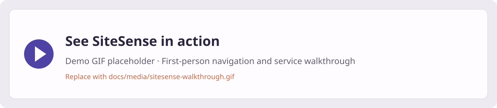
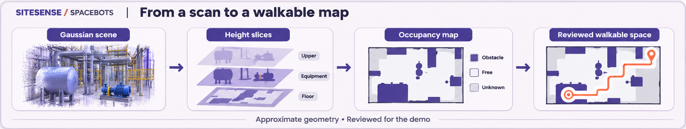
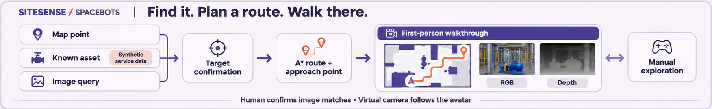
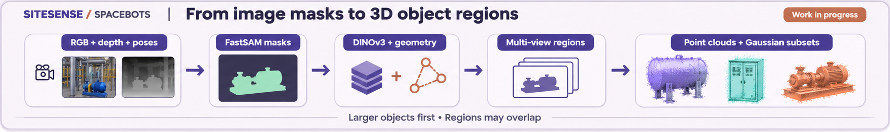

# SiteSense
**Team: SpaceBots · Company: Valmet**  
**Challenge: Industrial Metaverse: Semantic 3D Scene Understanding & Autonomous Field-Service Copilot**  
Since AI Hackathon 2026

## What we built

**1. A walkable map from a Gaussian scene.** We turned the supplied boiler-room scan into a 2D floor map, separating candidate walkable space from walls and equipment using height-based geometry and visual inspection.

**2. A first-person service walkthrough.** An A* planner guides a virtual service avatar through the map while a camera renders RGB and depth from the original Gaussian scene. There are four ways to explore:
- **Pick a point:** click a destination on the map and plan a route.
- **Choose a known asset:** navigate to one of 17 manually located objects. We assigned tags from Valmet’s asset list to these scene objects and linked the corresponding synthetic service records.
- **Search with an image:** upload a component photo, review the retrieved matches, and confirm a location before navigating.
- **Explore manually:** use the movement and head-tilt controls to inspect the environment yourself.

The view stays level while walking, then turns toward the selected object on arrival. Nearby asset information and workbook-based service details stay within reach.

**3. Semantic 3D extraction — work in progress.** We extracted around **115 larger object regions** as individual point clouds and original Gaussian subsets. Small components and complete object boundaries remain a challenge; regions can overlap.

**[Download the object assets on Google Drive][object-assets]** — point clouds, Gaussian subsets, and region metadata. The bundle manifest gives the exact exported count.

## Demo



<!-- Replace the line above with:

Keep the GIF short; link the full-resolution video separately.
-->

*A first-person trip to a selected asset, with the route, RGB/depth feed, and service information on one screen. Recording to be added.*

## How it works

### From scan to map
Height slices separate floor evidence from equipment and overhead structures. We project this into an occupancy grid and inspect the usable passages before planning.



### From target to first-person navigation
A clicked point, tagged asset, or confirmed image match becomes a target. A* finds an approach route; the avatar pose drives the virtual camera. Manual exploration bypasses the planner.



### From image observations to 3D regions
We rendered calibrated RGB/depth views, generated FastSAM masks, and extracted DINOv3 features. Appearance and multi-view geometry link observations; their surface samples and supporting original splats form separate, inspectable regions.



*Architecture illustrations are schematic, not screenshots. The manual service-object annotations and the larger automatic region collection are separate outputs.*

## Run locally

Development setup: **Ubuntu 22.04, Python 3.10, an NVIDIA RTX 4060 Laptop GPU with 8 GB VRAM, and 16 GB RAM**. Live rendering uses CUDA-enabled PyTorch and gsplat; ROS and Gazebo are not required.

For a new environment:

```bash
python3 -m venv .venv
source .venv/bin/activate
python -m pip install -r requirements-demo.txt
```

Install the matching CUDA/PyTorch/gsplat stack and restore the prepared data as described in [Setup](docs/SETUP.md). The original scene and larger data bundles are separate from Git. With the prepared manual-assets bundle in place:

```bash
bash service_demo/run.sh serve \
  --out outputs/service_demo/manual_v1 \
  --title "SITESENSE 3D" \
  --width 640 --height 480 --render-hz 2 \
  --port 8770 --open-browser
```

Open `http://127.0.0.1:8770`. Keep the terminal running. Add `--no-search` when the optional retrieval data is not installed; add `--no-render` for a map-only view. [Laptop run sheet](RUN_DEMO.md).

**Image search needs its saved retrieval index, matching DINOv3 checkpoint/code, source images, and masks.** These belong in an optional data download—not the source repository. [Data guide](docs/DATA.md).

## Other tools

| Folder | Purpose |
|---|---|
| `service_demo/` | Main browser demo: assets, image search, manual exploration |
| `manual_labeler/` | Label scene objects and save their 3D locations and boxes |
| `capture_dataset*/`, `camera_spawn_soft/` | Plan viewpoints and render calibrated observations |
| `segment_dataset/`, `feature_dataset/`, `associate_dataset/` | Masks, DINOv3 features, and cross-view association |
| `semantic_scene*/` | Inspect regions, clean clouds, and extract original splats |
| `semantic_animation/`, `semantic_showcase/` | Scene-to-object reveal and rotating object showcase |

Each module has its own README and `run.sh --help`. [Publication checklist](docs/PUBLISHING.md).

## Scope

This is a hackathon prototype, not a safety-certified navigation system. Routes avoid the map’s occupied cells; gray passages are allowed in the demo, and full 3D body clearance is not verified. Scale is provisional. Asset positions are manually annotated; health and service records are synthetic, as permitted by the challenge. Service briefs assemble workbook evidence rather than claiming new measured diagnoses.

Built with **gsplat, FastSAM, DINOv3, NumPy/SciPy, and a local Python/browser interface**. Models and supplied scene data retain their original terms. [Sources and acknowledgements](docs/ACKNOWLEDGEMENTS.md).

[object-assets]: GOOGLE_DRIVE_OBJECT_ASSETS_URL
